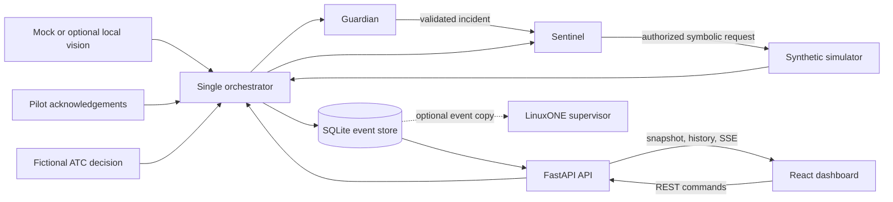
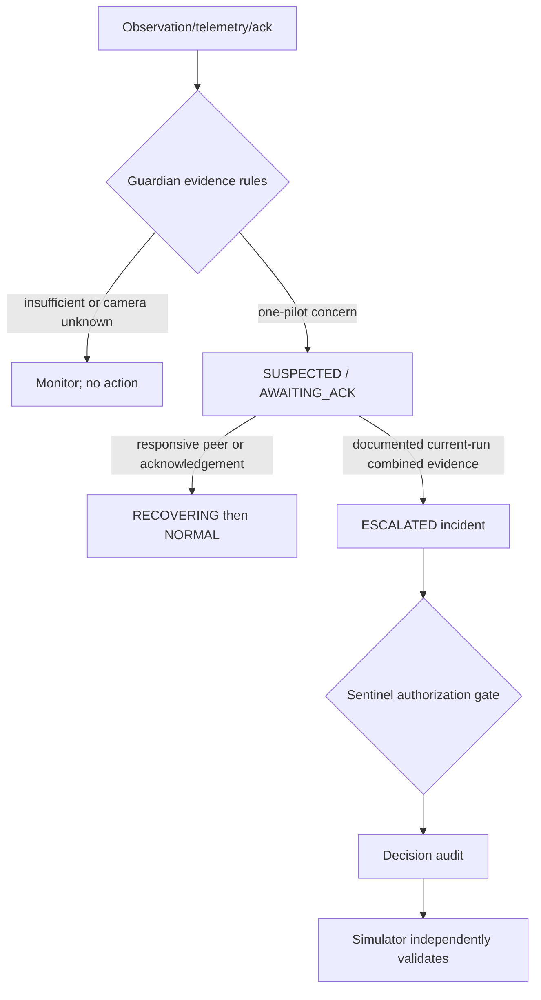
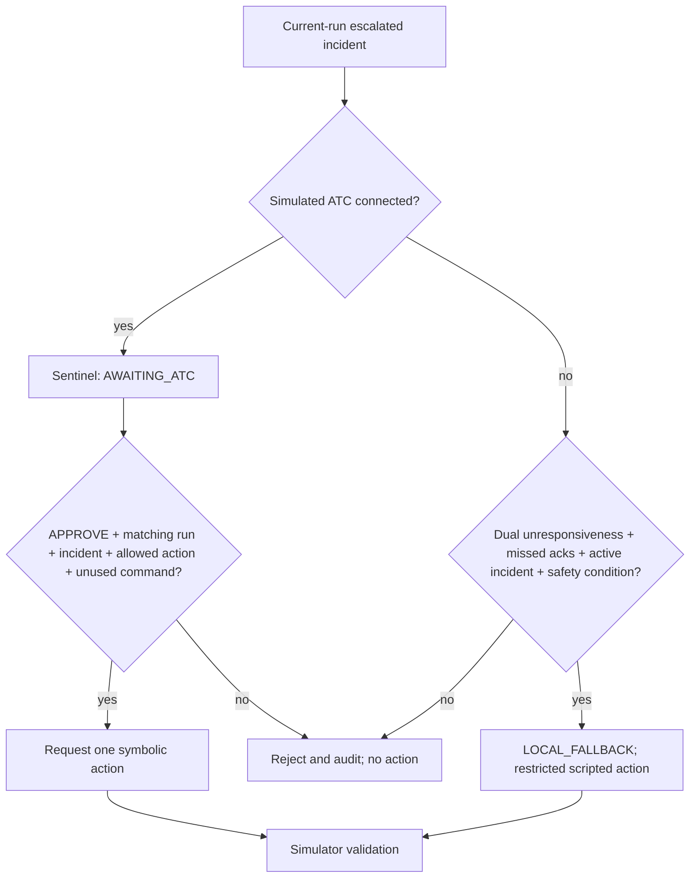
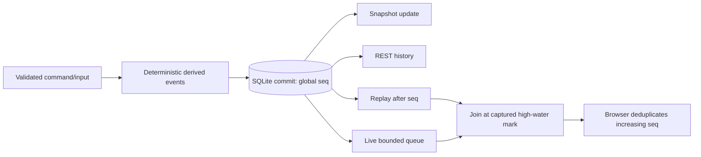

# AeroGuard Architecture

## Purpose and status

This document defines the architecture derived from the V3 master specification. The P0 branch implements the canonical contracts, deterministic mocks/scenarios, single orchestrator, FastAPI REST API, SQLite audit/idempotency store, generated contracts, and tests. React UI, race-safe SSE, advanced scenarios/CV, and LinuxONE remain P1.

> **SIMULATION ONLY — NOT FOR OPERATIONAL AVIATION USE**

## Goals and constraints

AeroGuard optimizes for a 24-hour datathon: deterministic local operation, explicit safety boundaries, stable typed contracts, independent module work, explainable decisions, and auditable events. It deliberately avoids distributed brokers, worker fleets, multiple backends, production identity claims, live aircraft inputs, and cloud dependencies. The default demo must run with mocks, no webcam, no IBM connection, and no paid credentials.

## High-level architecture



## Components and responsibilities

| Component | Responsibility | Explicit non-responsibility |
|---|---|---|
| React/Vite UI | Cockpit, fictional ATC, scenario controls, audit timeline | Does not infer incidents or authorize by itself |
| FastAPI API | Validate typed commands and serve state/history/events | Does not duplicate domain state machines |
| Orchestrator | Sole composition root; serialize commands; validate run/command identity; persist, apply, snapshot, publish | Does not contain owner-specific algorithms |
| Vision adapter | Produce bounded, typed pilot observations | Does not diagnose a medical condition |
| Simulator | Generate deterministic synthetic telemetry and validate allowed actions | Does not accept natural-language or real avionics commands |
| Guardian | Evaluate multiple evidence sources and track incident state | Never invokes the simulator |
| Sentinel | Validate escalation and connected/fallback authorization | Cannot bypass simulator validation |
| SQLite store | Append ordered events, deduplicate IDs, support history/replay | Reset never erases prior run history |
| Event publisher | Deliver only committed events to bounded subscribers | Is not the source of truth |
| LinuxONE supervisor | Optional remote intake, audit, analytics | Never sits in the local approval/control path |

## Event and command flow

```mermaid
sequenceDiagram
  participant UI
  participant API
  participant O as Orchestrator
  participant G as Guardian
  participant N as Sentinel
  participant S as Simulator
  participant DB as SQLite
  UI->>API: typed command
  API->>O: validated model
  O->>O: lock; verify run and deduplicate command
  O->>G: current-run typed event
  G-->>O: incident/decision events
  O->>N: verified incident and authorization inputs
  N-->>O: sentinel decision/action request
  O->>S: allowed symbolic action
  S-->>O: validated result
  O->>DB: append accepted and derived events in order
  DB-->>O: StoredEvent sequence IDs
  O-->>API: updated typed response
  API-->>UI: response; committed events via history/SSE
```

The exact atomic boundary must be fixed during implementation. At minimum, command IDs and event IDs are unique, committed events precede publication, and a retry cannot repeat a simulator side effect. Production exactly-once delivery is not claimed.

## Guardian-to-Sentinel workflow



Evidence event IDs and the exact triggered rule belong in the incident. Reset creates a new run, restores module states, and leaves old events queryable but unable to affect the active run.

## Connected and disconnected authorization



Changing the ATC-link simulation flag is only evidence about the scripted scenario. It is distinct from browser connectivity and remote-sync status.

## Event lifecycle and delivery



SSE `id` equals stored `seq`. The implementation must subscribe/capture a high-water mark before replay or use an equivalent lock so no event can fall between replay and live delivery. Clients discard sequence IDs not greater than the last applied ID. Bounded queues, disconnect cleanup, `Last-Event-ID`/`after_seq`, and REST history fallback are required. REST polling is acceptable for P0 if SSE is explicitly P1.

## State machines

Guardian states are `NORMAL`, `SUSPECTED`, `AWAITING_ACK`, `ESCALATED`, and `RECOVERING`. Sentinel states are `STANDBY`, `AWAITING_ATC`, `LOCAL_FALLBACK`, `SIM_ACTION_RUNNING`, `COMPLETED`, and `ABORTED`. Detailed target transitions and invariants are in [Contracts](CONTRACTS.md). Invalid transitions must produce an auditable rejection and never silently mutate state.

## Concurrency and persistence

The target runtime is one FastAPI process/worker with one orchestrator. Mutating commands pass through one application lock or serialized processor. Optional camera work must not block the event loop. SQLite must enforce unique `event_id`, globally increasing `seq`, and unique command identity; indexes support `after_seq` reads. Multi-worker in-memory state is unsupported.

The initial restart guarantee must be documented by the implementation. If snapshots/state cannot yet reconstruct fully from events, the limitation must be explicit. Audit history still must persist across reset.

## Fault handling and recovery

- Pydantic rejects malformed models at the API boundary using one error shape.
- Stale runs, incident mismatches, invalid actions, invalid transitions, rejected approvals, and duplicates fail predictably and create/return an auditable outcome.
- Remote sync failure cannot block local monitoring or action authorization.
- Browser disconnect drops its bounded subscription without changing domain state; REST history supports recovery.
- Scenario reset creates a new `scenario_run_id`, returns modules to initial state, and prevents old commands from driving the new run.

## Security and authorization boundary

The API is local/demo-only by default and must not be exposed publicly without a separate security design. The ATC screen is fictional and is not production authentication. Input validation, bounded pagination/queues, no committed secrets, and explicit simulation labels are mandatory. Optional remote intake should use authenticated transport when implemented, but no credential scheme is specified or claimed today.

## Design tradeoffs

- A single process and SQLite simplify ordering and integration but do not target horizontal scale.
- Deterministic rules are less flexible than learned policies but make safety gates testable and explainable.
- Generated types reduce drift but require a strict generator/check workflow.
- Mocks maximize local reliability; CV and LinuxONE remain optional integrations.
- REST-first P0 can launch sooner; race-safe SSE is deferred rather than shipped incorrectly.

## Source of truth

The [master specification](../AEROGUARD_CODEX_MASTER_BOOTSTRAP_V3.md) governs requirements. Once implemented, canonical source models and `interfaces.py` govern wire models and Protocol signatures; generated artifacts mirror them and are never edited manually.
